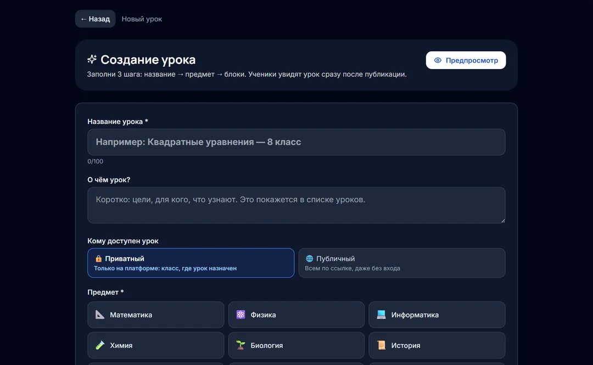
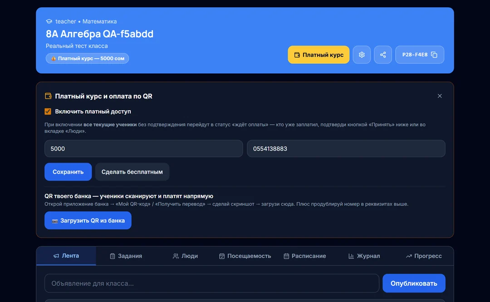
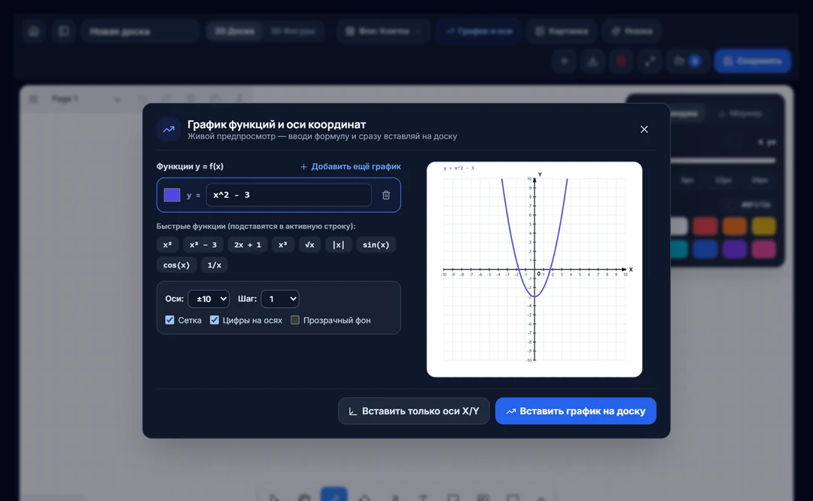
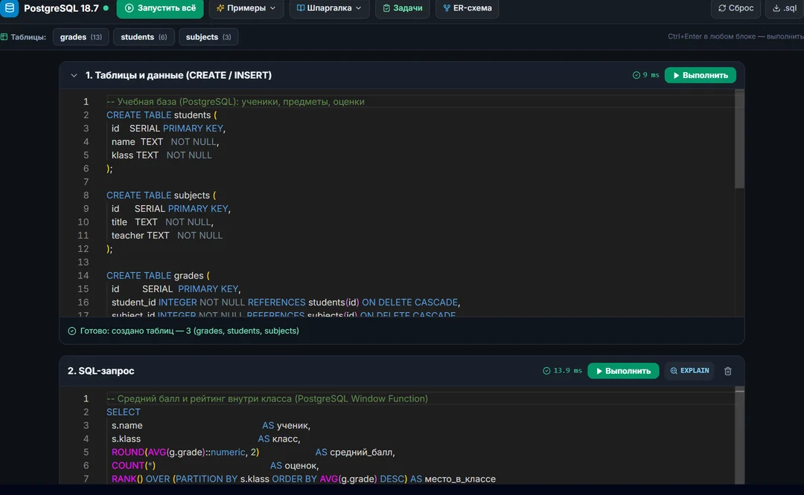
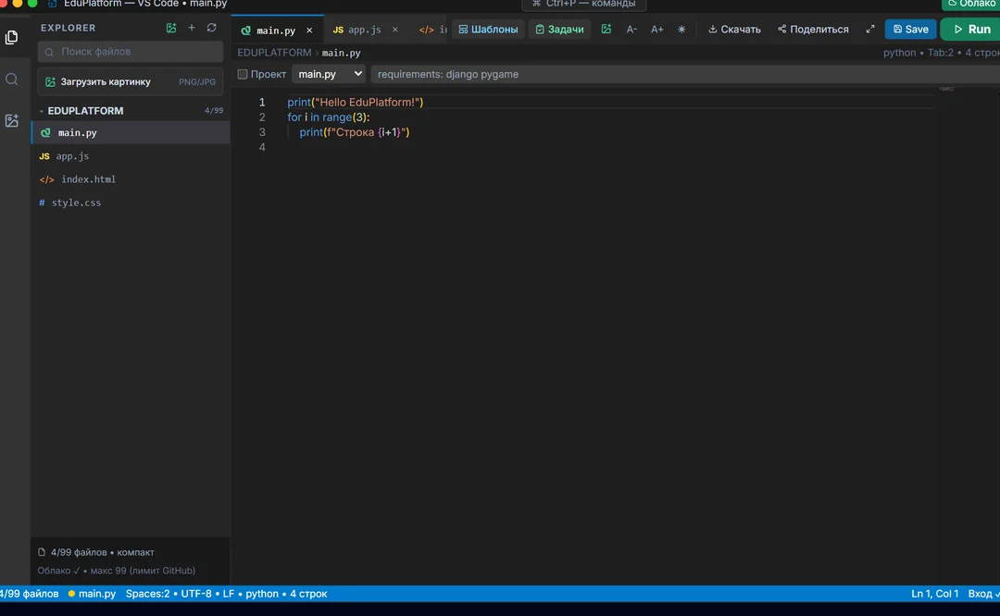
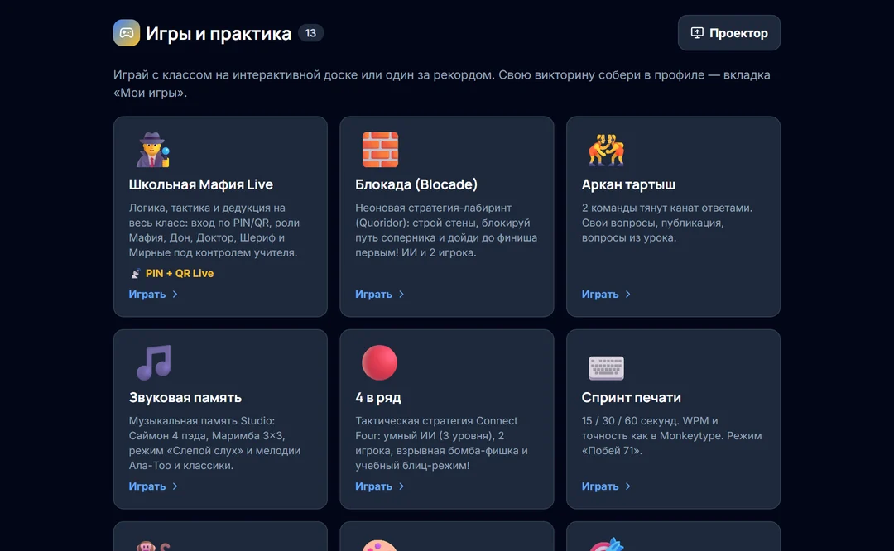

<div align="center">


# EduPlatform

**Интерактивная образовательная платформа нового поколения — уроки, классы с QR-оплатой, 2D/3D доска, VS Code, PostgreSQL 18 и живые игры в одном окне браузера.**

[](https://edu-frontend-l5kq.onrender.com)
[](https://edu-backend-8f07.onrender.com/api/health/)
[](https://edu-frontend-l5kq.onrender.com)
[](https://edu-frontend-l5kq.onrender.com)

[](https://react.dev/)
[](https://www.djangoproject.com/)
[](https://pglite.dev/)
[](https://threejs.org/)
[](https://tailwindcss.com/)

[Онлайн-демо](https://edu-frontend-l5kq.onrender.com) · [Обзор модулей](#-возможности-платформы) · [Скриншоты](#-внутри-платформы) · [Быстрый старт](#-быстрый-старт) · [Архитектура](#-структура-проекта) · [Промо-документ](STUDEXPO.md)

</div>

---

> **Онлайн-демо:** [edu-frontend-l5kq.onrender.com](https://edu-frontend-l5kq.onrender.com) · **Бэкенд:** [edu-backend-8f07.onrender.com](https://edu-backend-8f07.onrender.com)  
> **Демо-доступ:** логин `demo` · пароль `demo1234` · Гости сразу видят полноэкранный интерактивный лендинг, авторизованные пользователи — свой рабочий дашборд.

---

## 📸 Внутри платформы

<table>
  <tr>
    <td width="50%" align="center">
      
      <br /><sub><b>Конструктор уроков</b> — встроенный просмотр PDF HD, Word, Excel и презентаций</sub>
    </td>
    <td width="50%" align="center">
      
      <br /><sub><b>Классы (Classroom)</b> — задания, журнал-матрица, посещаемость и QR-оплата</sub>
    </td>
  </tr>
  <tr>
    <td width="50%" align="center">
      
      <br /><sub><b>Доска 2D / 3D</b> — настраиваемое перо, графики функций и 3D-стереометрия</sub>
    </td>
    <td width="50%" align="center">
      
      <br /><sub><b>SQL-лаборатория</b> — настоящий PostgreSQL 18 в браузере (Web Worker + ER-схема)</sub>
    </td>
  </tr>
  <tr>
    <td width="50%" align="center">
      
      <br /><sub><b>VS Code IDE</b> — Python, JS, HTML/CSS, живой терминал и предпросмотр</sub>
    </td>
    <td width="50%" align="center">
      
      <br /><sub><b>Игры Live</b> — Школьная Мафия по PIN/QR, Аркан тартыш, Блокада, Квиз</sub>
    </td>
  </tr>
</table>

---

## ✨ Возможности платформы

### 📚 Обучение и контент
- **Уроки-конструктор + ридер всех форматов** — сборка урока из блоков (текст, файлы, презентации, тесты, код, доска, видео) с автосохранением черновика. Встроенная читалка открывает **все страницы PDF в HD**, **DOCX / Word (.doc)**, **Excel (.xlsx, .xls, .csv)**, **TXT/MD**, **фото** и **PPTX** прямо внутри урока без скачивания.
- **Презентации как PowerPoint** — 14 фигур, таблицы, диаграммы, переходы, слайд-шоу. Импорт `.pptx` / `.pdf` 1-в-1 + режим **«Оригинал»** (PDF-двойник через LibreOffice) и тоггл **«Конструктор»** для мгновенного редактирования.
- **Мини-Word** — постраничный редактор документов с таблицами, изображениями, разрывами страниц, импортом/экспортом `.docx`, печатью и озвучкой.

### 🏫 Управление классами и проверка знаний
- **Классы как Google Classroom + платные курсы** — вступление по 6-значному коду, задания с дедлайнами, журнал-матрица `ученик × задание`, посещаемость, расписание, лента объявлений с комментариями, автоотчёт и **платные курсы с прямым QR-кодом банка** (Мбанк / О!Деньги / Элсом) и подтверждением чеков учителем.
- **Тесты с античитом и защитой от скриншотов** — 4 типа вопросов, таймер на вопрос, автогенерация по теме и **усиленный прокторинг (`shotGuard`)**: персональный водяной знак, контроль смены вкладки/окна, блокировка копирования, печати и `PrintScreen`.

### 💻 Практика: код, SQL и доска
- **Интерактивная доска 2D / 3D** — движок `tldraw` с настраиваемым карандашом и маркером (`1–40 px`, произвольный HEX-цвет), фоны (клетка, линейка, точки, меловая доска), **живой построитель математических графиков и осей**, лазерная указка и **3D-режим «Стереометрия»** на `Three.js` с кнопкой *«Снимок → 2D»*.
- **PostgreSQL 18 SQL-лаборатория** — полноценная СУБД на `PGlite` (WASM) в отдельном **Web Worker** (без подвисаний интерфейса, отклик ~9 ms), визуальная ER-схема, `EXPLAIN ANALYZE`, готовые датасеты и практические задачи с автопроверкой и записью оценок в журнал.
- **VS Code IDE (Python, JS, HTML, CSS)** — редактор `Monaco`, до 99 файлов, загрузка изображений в проект, живой интерактивный WebSocket-терминал (`input()`), изолированная песочница, live HTML-превью и автопроверка заданий.

### 🎮 Живые командные игры (13 режимов)
- **Школьная Мафия Live (PIN + QR)** — реальная WebSocket-игра на весь класс как Kahoot: ученики заходят со смартфонов, получают секретные роли (*Мафия, Дон, Доктор, Шериф, Мирные*), делают ночные ходы и голосуют днём; у учителя есть **режим проектора**, скрывающий роли на доске.
- **Командные и учебные игры** — **Аркан тартыш** (2 команды + перетягивание каната), **Билим-Квиз Live**, **Блокада (Quoridor)**, **Храбрый фермер 3D** (`Three.js`), **Спринт печати**, **Математическая битва**, **Виселица**, **Найди слово**, **Быстрые пары**, **Тренировка памяти** и др. Свой WebAudio-синтезатор и звуковая палитра.

### 🌍 Языки, адаптивность и доступность
- **Полный адаптив** — выверенная работа на смартфонах (`375px`), планшетах (`768px`), ноутбуках и интерактивных досках.
- **3 языка интерфейса** — **Русский**, **Кыргызча**, **English** (включая динамический автоперевод интерфейса и переключение на лету).
- **Режим для слабовидящих (ГОСТ Р 52872 / WCAG AAA)** — 4 контрастные схемы, масштаб шрифта 100–200%, межбуквенный и межстрочный интервал, встроенная озвучка и полная совместимость с `NVDA / JAWS / VoiceOver`.

---

## ⚖️ Сравнение с аналогами

| Возможность | EduPlatform | Google Classroom | Kahoot | Moodle |
|---|:---:|:---:|:---:|:---:|
| Конструктор уроков + встроенный PDF HD / Word / Excel | ✅ | ➖ | ❌ | ➖ |
| Классы, журнал, посещаемость и QR-оплата курсов | ✅ | ➖ | ❌ | ➖ |
| Тесты с защитой от скриншотов и автогенерацией | ✅ | ❌ | ➖ | ➖ |
| Интерактивная 2D/3D доска + построитель графиков | ✅ | ❌ | ❌ | ❌ |
| VS Code IDE (Python/JS/HTML) + PostgreSQL 18 в браузере | ✅ | ❌ | ❌ | ❌ |
| Живые игры класса по PIN/QR (Мафия Live, Квиз, Аркан) | ✅ | ❌ | ➖ | ❌ |
| Кыргызский, русский и английский + режим ГОСТ Р 52872 | ✅ | ➖ | ❌ | ➖ |
| 0 сом школам, без установки и платных лицензий | ✅ | ➖ | ❌ | ✅ |

---

## 🛠 Технологический стек

| Слой | Технологии |
|---|---|
| **Frontend** | React 18, TypeScript 5.5, Vite 5, Tailwind CSS, Lucide Icons |
| **Интерактивные движки** | Monaco Editor, tldraw (custom PenStroke + GraphBuilder), Three.js (WebGL 3D), PGlite (PostgreSQL 18 WASM Worker), PDF.js, Mammoth, SheetJS |
| **Backend** | Django 5.1, Django REST Framework 3.15, SimpleJWT, Django Channels 4 + Daphne (HTTP + WebSocket) |
| **БД и инфраструктура** | PostgreSQL 16 (+ pgvector) / SQLite (локальный быстрый старт), Redis 7, PgBouncer, Docker, WhiteNoise |
| **Документы и код** | PyMuPDF, python-docx, python-pptx, openpyxl, Pillow, LibreOffice (PDF-двойник), Piston / изолированный раннер |

---

## 📂 Структура проекта

```text
edu-platform/
├── apps/                        # 10 Django-приложений
│   ├── accounts/                # пользователи, роли, JWT-аутентификация
│   ├── assessments/             # тесты, античит, автогенерация, Школьная Мафия Live (WS)
│   ├── board/                   # сохранение и рендер 2D/3D досок
│   ├── catalog/                 # предметы, учебные программы, публичный каталог
│   ├── classroom/               # классы, задания, журнал, посещаемость, QR-оплата
│   ├── code/                    # запуск кода (HTTP + WebSocket ws/run), SQL-задачи
│   ├── content/                 # файлы, PDF/DOCX/Excel-превью, презентации, MediaBlob
│   ├── lessons/                 # уроки-конструктор
│   ├── notes/                   # заметки с напоминаниями
│   └── word/                    # мини-Word: документы, импорт/экспорт .docx
├── backend/                     # settings.py, asgi.py (HTTP + WS роутинг), urls.py
├── frontend/                    # React + TypeScript + Vite + Tailwind
│   ├── public/                  # logo.svg, локальные шрифты, about/*.webp
│   └── src/
│       ├── board/               # PenStrokeShapeUtil, GraphBuilderModal
│       ├── components/          # Layout, AboutVisuals, PdfViewer, InlineFileReader, sql/
│       ├── context/             # LangContext + autoTranslate (RU/KG/EN), UIContext
│       ├── pages/               # About, Dashboard, LessonBuilder, ClassroomDetail, Board,
│       │                        # SqlLab, VSCodeEditor, MafiaHost, MafiaPlay, Tests, Games...
│       └── utils/               # shotGuard (анти-скриншот), sanitize, sfx
├── docker-compose.yml           # PostgreSQL + Redis + PgBouncer + Piston + backend
├── Dockerfile                   # production-образ бэкенда (migrate + daphne)
├── render.yaml                  # конфигурация деплоя на Render
└── start-backend.ps1 / start-frontend.ps1
```

---

## 🚀 Быстрый старт

**Требования:** Python `3.11+`, Node.js `18+`, PostgreSQL (или Docker — для локальной разработки можно стартовать мгновенно на SQLite с `USE_SQLITE=1`).

### Вариант 1 — Локальный запуск (Windows PowerShell)

```powershell
# 1. Скопируй переменные окружения
Copy-Item .env.example .env

# 2. Запусти PostgreSQL + Redis (опционально; без них работает USE_SQLITE=1)
docker compose up -d db redis

# 3. Запусти бэкенд (миграции + Daphne HTTP/WebSocket на :8001)
powershell -ExecutionPolicy Bypass -File start-backend.ps1
```

В новом окне терминала подними фронтенд:

```powershell
cd frontend
npm install
npm run dev
```

- Фронтенд: `http://localhost:5173/`
- Проверка API: `http://127.0.0.1:8001/api/health/`

### Вариант 2 — Полный стек в Docker

```powershell
docker compose up -d
```

Поднимает PostgreSQL (+ `pgvector`), Redis, PgBouncer, Piston (песочницу кода) и бэкенд на `http://localhost:8000`.

### Production-сборка фронтенда

```powershell
cd frontend
npx tsc --noEmit
npm run build
npm run preview
```

---

<details>
<summary><b>⚙️ Переменные окружения (.env)</b></summary>

| Переменная | Назначение |
|---|---|
| `DJANGO_SECRET_KEY` | Секретный ключ Django |
| `DEBUG` | `True` только для локальной разработки |
| `DATABASE_URL` | `postgres://...` (или `USE_SQLITE=1` для быстрого старта) |
| `ALLOWED_HOSTS` | Разрешённые хосты через запятую |
| `CORS_ALLOWED_ORIGINS` | Разрешённые домены фронтенда |
| `VITE_API_URL` | URL бэкенда для сборки фронтенда (например, `http://localhost:8001`) |
| `GEMINI_API_KEY` / `GEMINI_MODEL` | Опциональный ключ ИИ-генерации (без него работает встроенный генератор) |
| `REDIS_URL` | Redis для Django Channels / кэша |
| `PISTON_URL` | Адрес изолированной песочницы Piston |

</details>

<details>
<summary><b>🔌 Основные API и WebSocket эндпоинты</b></summary>

- **Аутентификация:** `POST /api/auth/jwt/create/`, `GET /api/auth/me/`
- **Уроки и файлы:** `/api/lessons/`, `/api/files/`, `/api/files/{id}/preview/` (PDF/DOCX/Excel), `/api/presentations/`, `/api/word-docs/`
- **Классы и оплата:** `/api/classrooms/` (`join`, `members`, `gradebook`, `payment_qr_upload`, `payment_receipt`, `approve_payment`, `ai_report`), `/api/assignments/`, `/api/announcements/`
- **Тесты и прокторинг:** `/api/tests/`, `/api/tests/generate/`, `/api/tests/{id}/answer/`
- **Код и SQL:** `/api/code/run/`, `/api/code-tasks/{id}/submit_sql/`, `ws/run/`
- **Игры Live:** `/api/live-mafia/create/`, `/api/live-mafia/check/{pin}/`, `ws/mafia/{pin}/`, `ws/quiz/{pin}/`
- **Доска и заметки:** `/api/boards/`, `/api/notes/`

</details>

<details>
<summary><b>☁️ Деплой на Render</b></summary>

- **Backend:** Docker-сервис из `Dockerfile` — при запуске автоматически применяет `manage.py migrate` и поднимает `daphne` (HTTP + WebSocket на одном порту).
- **Frontend:** Static Site — build `cd frontend && npm ci && npm run build`, publish `frontend/dist`.
- **Постоянство медиа:** загруженные документы, QR-коды и изображения сохраняются в `MediaBlob` в БД, поэтому файлы не пропадают при редеплоях.

</details>

---

<div align="center">

<sub>Спроектировано и разработано в <b>Snille Studios</b> · 2026</sub>

</div>
